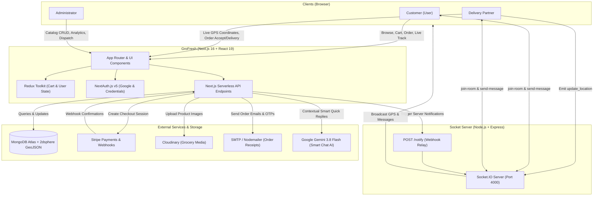

# 🛒 GroFresh — Hyper-Local Real-Time Grocery Delivery Platform

[](https://nextjs.org/)
[](https://react.dev/)
[](https://tailwindcss.com/)
[](https://socket.io/)
[](https://www.mongodb.com/)
[](https://stripe.com/)
[](https://ai.google.dev/)

**GroFresh** is a full-stack, enterprise-grade, real-time hyper-local grocery delivery platform. It unifies **Customers**, **Delivery Partners**, and **Store Administrators** into a single cohesive ecosystem featuring live GPS driver tracking, room-based order chat with Google Gemini AI-generated smart replies, interactive Leaflet map checkout with pin-point reverse geocoding, Stripe payment processing with webhook verification, delivery OTP security handoff, and transactional email notifications.

---

## 📑 Table of Contents

- [Architectural Overview](#-architectural-overview)
- [Key Features by Persona](#-key-features-by-persona)
  - [1. Customer Experience (User)](#1-customer-experience-user)
  - [2. Delivery Partner Portal (Delivery Boy)](#2-delivery-partner-portal-delivery-boy)
  - [3. Store Administrator Command Center (Admin)](#3-store-administrator-command-center-admin)
  - [4. Real-Time Microservice (Socket Server)](#4-real-time-microservice-socket-server)
  - [5. Gemini AI Assistant](#5-gemini-ai-assistant)
- [Technology Stack](#-technology-stack)
- [Database Architecture & Schemas](#-database-architecture--schemas)
- [Real-Time WebSocket Protocol](#-real-time-websocket-protocol)
- [Repository Structure](#-repository-structure)
- [Environment Variables Configuration](#-environment-variables-configuration)
- [Step-by-Step Installation & Setup](#-step-by-step-installation--setup)
- [Stripe Local Webhook Testing](#-stripe-local-webhook-testing)
- [REST API Endpoints Reference](#-rest-api-endpoints-reference)
- [Deployment Guidelines](#-deployment-guidelines)
- [License](#-license)

---

## 🏛 Architectural Overview

The repository is organized into a modular multi-package architecture:

```
grocery-delivery-website/
├── GroFresh/        # Full-stack Next.js 16 Web App (App Router + Turbopack, SSR, API routes)
└── socketServer/    # Standalone Node.js + Express + Socket.IO microservice for real-time events
```

### System Architecture Flow



---

## 🌟 Key Features by Persona

### 1. Customer Experience (User)
* **Authentication & Onboarding**: Seamless login via Google OAuth or Email/Password credentials; phone number & role verification workflow.
* **Smart Catalog Navigation**: Browse 12+ categories (Fruits & vegetables, Dairy, Snacks, Cold drinks, Rice & dals, etc.) and deep subcategories with instant filtering.
* **Persistent Reactive Cart**: Redux Toolkit-backed cart with optimistic quantity adjustments and persistent state.
* **Interactive Leaflet Map Checkout**: Pinpoint delivery address selector on an interactive OpenStreetMap canvas with reverse geocoding via Leaflet-GeoSearch.
* **Flexible Payments**: Choice between Cash on Delivery (COD) and Online Card Payment via Stripe Checkout Sessions.
* **Live Order Tracking**: Interactive map displaying store location, delivery destination, and real-time moving delivery partner marker.
* **In-App Live Chat**: Real-time messaging with the assigned driver inside the order tracking interface.
* **AI Quick Replies**: Instant context-aware WhatsApp-style suggestion chips powered by Google Gemini 3.8 Flash.
* **Order History & Secure OTP Delivery**: View historical orders with status timeline; receive a secure delivery OTP for verifying physical handoff.

### 2. Delivery Partner Portal (Delivery Boy)
* **Real-time Geolocation Beacon (`GeoUpdater`)**: Tracks browser GPS via `navigator.geolocation` and streams coordinates over WebSockets to MongoDB and client maps.
* **Delivery Radar & Assignment Hub**: Real-time broadcast inbox displaying new order dispatch opportunities with instant **Accept** / **Reject** triggers.
* **Turn-by-Turn Route Visualizer**: Dynamic Leaflet map displaying customer drop location and shortest route guidance.
* **Status Progression Pipeline**:
  `broadcasted` ➔ `assigned` ➔ `pickup_inprogress` ➔ `picked_up` ➔ `delivery_inprogress` ➔ `delivered`.
* **OTP Verification**: Enter customer OTP directly in the portal to confirm order completion and trigger automated delivery confirmation emails.
* **Driver Chat Hub**: Real-time communication with customer with AI-generated driver quick replies (*"On my way! 🚴"*, *"Arrived at drop location 📍"*).

### 3. Store Administrator Command Center (Admin)
* **Executive Metrics Dashboard**: Live revenue totals, active order counters, customer metrics, and online delivery partner counts.
* **Catalog Inventory Management (CRUD)**: Add, edit, and remove groceries with unit specifications, pricing, category classifications, and Cloudinary media upload.
* **Order Lifecycle & Dispatch Control**: Real-time order grid with manual/automatic delivery boy assignment and manual status override capabilities (`pending`, `outForDelivery`, `delivered`, `cancelled`).
* **Delivery Personnel Management**: Real-time monitoring of delivery boy availability, connection state, and GPS locations.

### 4. Real-Time Microservice (Socket Server)
* **Low-Latency Bi-Directional Events**: High-performance Socket.IO service running on port 4000.
* **Driver Location Broadcast**: Receives coordinates from delivery personnel and broadcasts them to listening customer order tracking maps.
* **Chat Room Multiplexing**: Isolated room channels (`join-room`) for each order to enable private customer-driver communication.
* **Next.js `/notify` Webhook Relay**: Secure HTTP endpoint allowing Next.js backend API routes to dispatch real-time events to individual sockets or broadcast across all clients.

### 5. Gemini AI Assistant
* **Context-Aware Quick Replies**: Integrated with Google Gemini 3.8 Flash API (`/api/chat/ai`).
* Analyzes the last chat message and user role to generate three concise, natural, emoji-enhanced quick reply buttons (e.g. *"Please leave it at the door 📦"*, *"I am at home 👍"*).

---

## 🛠 Technology Stack

| Domain | Technology / Library | Description |
|---|---|---|
| **Frontend Framework** | **Next.js 16.4.0 (App Router)** | React Server Components, Turbopack, nested layouts |
| **UI Library** | **React 19.3.0** | Modern React with concurrent rendering |
| **Styling** | **Tailwind CSS v4** | Modern utility-first CSS engine with `@tailwindcss/turbopack` |
| **Icons & Animation** | **Lucide React & Motion** | Clean modern iconography and Framer Motion micro-interactions |
| **State Management** | **Redux Toolkit 2.13.0** | Global client state for shopping cart and user profile |
| **Maps & Geolocation** | **Leaflet 1.9.4 & React-Leaflet** | OpenStreetMap integration, custom markers, reverse geocoding |
| **Geocoding** | **Leaflet-GeoSearch 4.4.0** | Search bar and address geocoding on checkout maps |
| **Authentication** | **NextAuth.js v5 (beta.32)** | OAuth (Google) + Credentials provider with JWT strategy |
| **Database & ODM** | **MongoDB Atlas + Mongoose 9.11** | NoSQL document database with `2dsphere` spatial indexing |
| **Real-time Server** | **Socket.IO 4.8.4 & Express 5.3** | Standalone Node.js WebSocket engine & broadcast relay |
| **Payments** | **Stripe SDK 23.0.0** | Hosted Checkout Sessions and webhook signature validation |
| **File Storage** | **Cloudinary SDK 2.11** | Cloud media storage for grocery product photography |
| **Email Transporter** | **Nodemailer 8.0** | Transactional emails for order confirmation and receipts |
| **Generative AI** | **Google Gemini 3.8 Flash** | REST API for contextual quick reply generation |
| **HTTP Client** | **Axios 1.20** | Promise-based HTTP client for API communication |

---

## 🗄 Database Architecture & Schemas

The database leverages **Mongoose** connected to **MongoDB Atlas**, utilizing 5 core models:

### 1. `User` (`user.model.ts`)
```typescript
{
  name: String,
  email: { type: String, unique: true },
  password?: String,
  mobile?: String,
  role: "user" | "deliveryBoy" | "admin",
  image?: String,
  location: {
    type: { type: String, enum: ["Point"], default: "Point" },
    coordinates: [Number, Number] // [longitude, latitude] (2dsphere indexed)
  },
  socketId: String | null,
  isOnline: Boolean
}
```

### 2. `Grocery` (`grocery.model.ts`)
```typescript
{
  name: String,
  category: GroceryCategory,    // Validated against GROCERY_CATEGORIES
  subCategory: String,          // Validated against CATEGORY_SUBCATEGORIES
  image: String,                // Cloudinary secure URL
  price: Number,
  unit: String                  // e.g., '1 kg', '500 g', '1 pc', '1 L'
}
```

### 3. `Order` (`order.model.ts`)
```typescript
{
  userId: ObjectId -> User,
  items: [{
    groceryId: ObjectId -> Grocery,
    name: String,
    image: String,
    price: Number,
    unit: String,
    quantity: Number
  }],
  totalAmount: Number,
  paymentMethod: "online" | "cash",
  isPaid: Boolean,
  deliveryAddress: {
    fullName: String,
    phone: String,
    street: String,
    city: String,
    state: String,
    pincode: String,
    latitude: Number,
    longitude: Number
  },
  status: "pending" | "outForDelivery" | "delivered" | "cancelled",
  assignment?: ObjectId -> DeliveryAssignment,
  assignedDeliveryBoy?: ObjectId -> User,
  deliveryOtp: String | null,
  deliveryOtpVerification: Boolean,
  deliveredAt: Date
}
```

### 4. `DeliveryAssignment` (`deliveryAssignment.model.ts`)
```typescript
{
  orderId: ObjectId -> Order,
  broadCastedTo: [ObjectId -> User],
  selectedDeliveryPerson: ObjectId -> User,
  status: "broadcasted" | "assigned" | "pickup_inprogress" | 
          "picked_up" | "delivery_inprogress" | "delivered" | "cancelled",
  acceptedAt: Date,
  outForDeliveryAt: Date,
  deliveredAt: Date
}
```

### 5. `Message` (`message.model.ts`)
```typescript
{
  roomId: ObjectId -> Order,
  text: String,
  senderId: ObjectId -> User,
  time: String
}
```

---

## ⚡ Real-Time WebSocket Protocol

The `socketServer` coordinates real-time synchronization between clients:

| Event Name | Direction | Payload | Description |
|---|---|---|---|
| `connection` | Client ➔ Server | Socket handshake | Establishes WebSocket channel |
| `user_online` | Client ➔ Server | `userId` | Maps `socket.id` to database user record |
| `update_location` | Driver ➔ Server | `{ userId, latitude, longitude }` | Updates driver's GeoJSON point in MongoDB and triggers broadcast |
| `update-deliveryBoy-location` | Server ➔ Clients | `{ userId, location }` | Broadcasts moving marker location to order tracking map |
| `join-room` | Client ➔ Server | `roomId` (`orderId`) | Subscribes socket to private order chat room |
| `send-message` | Client ➔ Server | `{ roomId, text, senderId, time }` | Persists message to MongoDB and emits to room participants |
| `POST /notify` | Next.js API ➔ Server | `{ event, data, socketId? }` | Webhook allowing Next.js to push alerts or broadcast order events |

---

## 📁 Repository Structure

```
grocery-delivery-website/
├── README.md                          # Comprehensive project documentation
├── GroFresh/                          # Next.js 16 Full-Stack Application
│   ├── .env.local                     # Environment variables (Next.js)
│   ├── next.config.ts                 # Next.js configuration
│   ├── package.json                   # Next.js dependencies & scripts
│   ├── tsconfig.json                  # TypeScript configuration
│   ├── public/                        # Static assets & icons
│   └── src/
│       ├── auth.ts                    # NextAuth v5 configuration & callbacks
│       ├── InitUser.tsx               # Client user session synchronizer
│       ├── Provider.tsx               # Root React context & Redux wrapper
│       ├── proxy.ts                   # Forwarding proxies & network helpers
│       ├── app/                       # Next.js App Router
│       │   ├── layout.tsx             # Root layout with fonts & metadata
│       │   ├── page.tsx               # Role-based dashboard dispatcher
│       │   ├── globals.css            # Tailwind CSS v4 styling rules
│       │   ├── login/                 # User & Partner login page
│       │   ├── register/              # User & Partner registration page
│       │   ├── shop/                  # Full grocery shopping catalog page
│       │   ├── (admin)/               # Administrator protected routes
│       │   │   ├── admin-dashboard/   # Metrics and analytics
│       │   │   ├── add-grocery/       # Inventory item addition
│       │   │   ├── groceries/         # Inventory management
│       │   │   └── manage-orders/     # Order dispatch & assignments
│       │   ├── (user)/                # Customer protected routes
│       │   │   ├── checkout/          # Cart & Leaflet map address checkout
│       │   │   ├── orders/            # Order history view
│       │   │   ├── order-success/     # Post-purchase confirmation
│       │   │   └── track-order/       # Live driver tracking & chat
│       │   └── api/                   # Serverless REST endpoints
│       │       ├── admin/             # Inventory, metrics, order dispatch
│       │       ├── auth/              # NextAuth route handlers
│       │       ├── chat/              # Chat history, persistence & Gemini AI
│       │       ├── deliveryBoy/       # Order assignments, status, OTP verify
│       │       ├── groceries/         # Public catalog queries
│       │       ├── socket/            # User socket connect & location sync
│       │       └── user/              # Orders, profile, Stripe payment
│       ├── components/                # Modular React UI components
│       │   ├── AdminDashboard.tsx     # Admin control panel
│       │   ├── DeliveryBoyDashboard.tsx # Driver assignment & delivery panel
│       │   ├── DeliveryBoyChat.tsx    # Live messaging UI with Gemini AI chips
│       │   ├── LiveMap.tsx            # Leaflet real-time driver tracking map
│       │   ├── CheckoutMap.tsx        # Address selector with geocoding
│       │   ├── Cart.tsx               # Sliding cart drawer
│       │   ├── Navbar.tsx             # Navigation header with search & badges
│       │   ├── GroceryItemCard.tsx    # Product presentation & quantity controls
│       │   ├── HeroSection.tsx        # Homepage hero & promo banner
│       │   ├── GeoUpdater.tsx         # Background GPS geolocation emitter
│       │   └── OrdersClient.tsx       # Customer orders management
│       ├── lib/                       # Utility libraries
│       │   ├── db.ts                  # Mongoose MongoDB connection pooling
│       │   ├── cloudinary.ts          # Cloudinary SDK media uploader
│       │   ├── emitEventHandler.ts    # Socket server webhook dispatcher
│       │   ├── grocery-categories.ts  # Taxonomy & categories dictionary
│       │   ├── mail.ts                # Nodemailer Gmail transport
│       │   └── socket.ts              # Client-side Socket.IO instance
│       ├── models/                    # Mongoose database schemas
│       │   ├── user.model.ts          # User & delivery partner schema
│       │   ├── grocery.model.ts       # Product inventory schema
│       │   ├── order.model.ts         # Customer order schema
│       │   ├── deliveryAssignment.model.ts # Dispatch & assignment schema
│       │   └── message.model.ts       # Real-time chat message schema
│       └── redux/                     # Redux Toolkit state
│           ├── store.ts               # Root Redux store
│           ├── cartSlice.ts           # Cart reducer & actions
│           └── userSlice.ts           # User profile state
└── socketServer/                      # Real-time WebSocket Microservice
    ├── .env                           # Socket server configuration
    ├── index.js                       # Express + Socket.IO server implementation
    └── package.json                   # Socket server dependencies & start script
```

---

## 🔑 Environment Variables Configuration

### 1. `GroFresh/.env.local`

Create a `.env.local` file inside the `GroFresh/` directory:

```env
# MongoDB Connection String
MONGODB_URL="mongodb+srv://<username>:<password>@cluster0.xxxx.mongodb.net/GroFresh?retryWrites=true&w=majority"

# NextAuth.js Configuration
AUTH_SECRET="your_secure_generated_random_secret_string"
NEXT_BASE_URL="http://localhost:3000"

# Google Cloud OAuth Credentials (Google Sign-In)
GOOGLE_CLIENT_ID="your_google_client_id.apps.googleusercontent.com"
GOOGLE_CLIENT_SECRET="your_google_client_secret"

# Cloudinary (Product Image Uploads)
CLOUDINARY_CLOUD_NAME="your_cloudinary_cloud_name"
CLOUDINARY_API_KEY="your_cloudinary_api_key"
CLOUDINARY_API_SECRET="your_cloudinary_api_secret"

# Stripe Payment Gateway
STRIPE_SECRET_KEY="sk_test_51xxxxxxxxxxxxxxxxxxxxxxxxxxxx"
STRIPE_WEBHOOK_SECRET="whsec_xxxxxxxxxxxxxxxxxxxxxxxxxxxx"

# Socket Server Microservice URL
NEXT_PUBLIC_SOCKET_SERVER="http://localhost:4000"

# Google Gemini API Key (Contextual Chat Smart Replies)
GEMINI_API_KEY="AIzaSyxxxxxxxxxxxxxxxxxxxxxxxxxxxx"

# SMTP Transactional Email (Gmail App Password)
EMAIL="your_email@gmail.com"
PASS="xxxx xxxx xxxx xxxx"
```

### 2. `socketServer/.env`

Create a `.env` file inside the `socketServer/` directory:

```env
# Allowed CORS Origin from Next.js Frontend
NEXT_BASE_URL="http://localhost:3000"

# Socket.IO Listening Port
PORT=4000
```

---

## 🚀 Step-by-Step Installation & Setup

### Prerequisites
* **Node.js**: `v18.18+` or `v20+` installed.
* **npm**: `v9+` or `v10+` installed.
* **MongoDB**: A free MongoDB Atlas cluster or local MongoDB instance running.
* **Stripe Account**: For testing online checkout.
* **Cloudinary Account**: For image asset hosting.

---

### Step 1: Clone the Repository
```bash
git clone https://github.com/your-username/grocery-delivery-website.git
cd grocery-delivery-website
```

---

### Step 2: Configure & Start the Socket Server
Open a terminal tab and navigate into `socketServer`:

```bash
cd socketServer
npm install
npm run dev
```

*The socket server will start listening at `http://localhost:4000`.*

---

### Step 3: Configure & Start the GroFresh Web Application
Open a second terminal tab and navigate into `GroFresh`:

```bash
cd GroFresh
npm install
npm run dev
```

*The Next.js application will compile using Turbopack and start on `http://localhost:3000`.*

---

## 💳 Stripe Local Webhook Testing

To test online payment completion and automatic order status transitions locally, use the official **Stripe CLI**:

1. **Install Stripe CLI**:
   - Windows (via Scoop/Chocolatey): `scoop install stripe` or download from [stripe.com/docs/stripe-cli](https://stripe.com/docs/stripe-cli).
   - macOS: `brew install stripe/stripe-cli/stripe`.

2. **Authenticate with your Stripe Account**:
   ```bash
   stripe login
   ```

3. **Forward Webhook Events to your local Next.js API**:
   ```bash
   stripe listen --forward-to localhost:3000/api/user/stripe
   ```

4. **Copy the webhook secret output**:
   Set `STRIPE_WEBHOOK_SECRET` in `GroFresh/.env.local` to the signing secret printed in your terminal (e.g. `whsec_...`).

---

## 📡 REST API Endpoints Reference

### 🔐 Authentication (`/api/auth/*`)
- `GET/POST /api/auth/[...nextauth]` — NextAuth OAuth callbacks, credentials verification, session retrieval.

### 👤 User Endpoints (`/api/user/*`)
- `POST /api/user/order` — Place a new grocery order (COD or initialize online).
- `POST /api/user/payment` — Create a Stripe Checkout Session for order total.
- `POST /api/user/stripe` — Stripe webhook receiver for `checkout.session.completed`.
- `GET /api/user/get-order` — Fetch list of active and completed orders for user.
- `POST /api/user/edit-role-mobile` — Complete user profile (phone number & role selection).

### 🛍 Grocery Catalog (`/api/groceries/*`)
- `GET /api/groceries` — Retrieve active grocery items filtered by category or search term.

### 🛵 Delivery Partner Endpoints (`/api/deliveryBoy/*`)
- `GET /api/deliveryBoy/get-assignments` — Retrieve pending and active delivery tasks.
- `POST /api/deliveryBoy/accept-assignment` — Accept broadcasted delivery order.
- `POST /api/deliveryBoy/update-status` — Update order delivery phase (`pickup_inprogress`, `picked_up`, etc.).
- `POST /api/deliveryBoy/otp` — Verify customer delivery OTP to complete drop-off.

### 👑 Administrator Endpoints (`/api/admin/*`)
- `GET /api/admin/dashboard-stats` — Fetch revenue, user counts, and order statistics.
- `POST /api/admin/add-grocery` — Upload image to Cloudinary and create grocery item.
- `GET /api/admin/groceries` — List and filter all inventory items.
- `GET /api/admin/get-orders` — View all orders across the system.
- `POST /api/admin/update-order` — Assign delivery partner or modify order status.

### 💬 Real-Time Chat & AI Endpoints (`/api/chat/*`)
- `GET /api/chat/messages?roomId=<orderId>` — Fetch historical chat messages for an order.
- `POST /api/chat/save` — Persist chat message sent over WebSockets.
- `POST /api/chat/ai` — Request Gemini 3.8 Flash AI quick reply suggestions based on role and context.

### ⚡ Socket Integration (`/api/socket/*`)
- `POST /api/socket/connect` — Record connected user socket ID.
- `POST /api/socket/update-location` — Update MongoDB GeoJSON coordinates for active delivery partner.

---

## 🌐 Deployment Guidelines

### Deploying `GroFresh` (Frontend & API)
- **Vercel** (Recommended):
  1. Import the `GroFresh` directory as the project root.
  2. Framework Preset: **Next.js**.
  3. Configure all environment variables in project settings.
  4. Ensure `NEXT_PUBLIC_SOCKET_SERVER` points to your deployed socket server instance.

### Deploying `socketServer` (WebSocket Microservice)
- **Render / Railway / Fly.io / DigitalOcean**:
  1. Deploy `socketServer` as a persistent Node.js web service (WebSockets require long-lived connections, not serverless).
  2. Set `PORT` (e.g. `8000` or `4000`) and `NEXT_BASE_URL` to your production frontend URL.
  3. Update `GroFresh`'s `NEXT_PUBLIC_SOCKET_SERVER` to match your deployed socket domain (e.g., `https://grofresh-socket.onrender.com`).